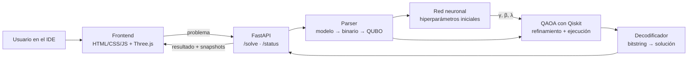

<p align="center">
  
</p>

# OptiQ

OptiQ es una plataforma interactiva que permite resolver problemas de **programación entera binaria** declarados en una sintaxis estilo **MiniZinc** usando **QAOA** (Quantum Approximate Optimization Algorithm). Un IDE en línea recibe el problema, un backend en FastAPI lo traduce a una formulación QUBO/Ising, una red neuronal propone los hiperparámetros iniciales del circuito y Qiskit ejecuta el algoritmo cuántico. Todo el proceso se visualiza en tiempo real con animaciones 3D hechas con Three.js.

<p align="center">
  
</p>

El proyecto nace en un hackathon y está pensado para explorar cómo los lenguajes declarativos pueden conectarse con la computación cuántica, y cómo hacer visible (y entendible) lo que pasa dentro de un algoritmo variacional.

## ¿Por qué es importante este proyecto?

La computación cuántica tiene el potencial de revolucionar la optimización combinatoria en áreas críticas como logística, finanzas, diseño de fármacos y redes energéticas. Sin embargo, su adopción actual enfrenta tres grandes barreras que **OptiQ** busca resolver:

1. **Cerrar la brecha de abstracción:** Hoy en día, utilizar un procesador cuántico exige formular problemas a nivel de compuertas o matrices Ising/QUBO, requiriendo conocimiento profundo de física cuántica. OptiQ permite modelar de forma natural usando sintaxis declarativa tipo **MiniZinc** (el estándar de la industria y la academia en programación con restricciones), traduciendo automáticamente el problema a un formato ejecutable cuánticamente.
2. **Superar los cuellos de botella variacionales (QAOA + ML):** En la era NISQ (*Noisy Intermediate-Scale Quantum*), los algoritmos variacionales como QAOA sufren del problema de mesetas estériles (*barren plateaus*) y lentitud de convergencia si arrancan con parámetros aleatorios. Al integrar una **red neuronal (PINN)** que infiere hiperparámetros iniciales prometedores $(\gamma, \beta, \lambda)$ según la topología del problema, OptiQ reduce drásticamente el número de iteraciones y disparos (*shots*) necesarios.
3. **Desmitificar la "caja negra" cuántica:** Los algoritmos cuánticos suelen ser difíciles de interpretar intuitivamente. La interfaz con **visualización 3D interactiva en Three.js** convierte la ejecución en un proceso transparente, educativo y tangible, permitiendo ver en tiempo real cómo los qubits exploran el espacio de soluciones y convergen hacia el estado de mínima energía.

## Características

- IDE en línea para declarar problemas con sintaxis similar a MiniZinc (variables binarias, restricciones lineales y función objetivo).
- Parser que convierte el modelo declarativo en un problema de programación binaria, y de ahí a QUBO/Ising.
- Manejo de restricciones mediante términos de penalización, con variables de holgura (slack) para desigualdades.
- Implementación de QAOA con Qiskit y simulación local con Qiskit Aer.
- Red neuronal que predice los mejores hiperparámetros iniciales (γ, β y peso de penalización λ) para acelerar la convergencia.
- Visualización 3D con Three.js del flujo completo: envío del problema, procesamiento de la red neuronal, optimización de parámetros y evolución del circuito cuántico.
- API con FastAPI para conectar el frontend con los motores de ejecución.
- _(Planeado)_ Registro como solver externo de MiniZinc mediante un archivo `.msc`, consumiendo FlatZinc.
- _(Planeado)_ Comparativa de resultados: parámetros aleatorios vs. parámetros predichos por la red, contra el óptimo clásico.

## Vista general de la arquitectura

OptiQ está organizado como un monorepo con dos aplicaciones:

- `frontend/` contiene la interfaz web: el editor del IDE y el canvas 3D con las animaciones del proceso.
- `backend/` contiene el servicio FastAPI. Expone los endpoints y delega el parseo, la predicción de hiperparámetros y la ejecución cuántica a los módulos `parser`, `ml` y `quantum`.



## Estructura del proyecto

```text
HACKATONQ/
├── frontend/
│   ├── index.html               # Interfaz principal, contenedor del IDE y el canvas 3D
│   ├── css/
│   │   └── style.css            # Estilos de la aplicación
│   └── js/
│       ├── main.js              # Controlador principal y conexión entre módulos
│       ├── ide.js               # Editor de texto y preparación del envío del problema
│       └── visualization.js     # Animaciones 3D con Three.js
├── backend/
│   ├── main.py                  # Servidor FastAPI principal
│   ├── requirements.txt         # Dependencias de Python (fastapi, uvicorn, qiskit, torch, etc.)
│   ├── api/
│   │   └── router.py            # Endpoints de la API (/solve, /status)
│   ├── parser/
│   │   └── problem_parser.py    # Lenguaje declarativo → problema binario → QUBO
│   ├── ml/
│   │   └── pinn_model.py        # Red neuronal para predecir hiperparámetros
│   └── quantum/
│       └── qaoa_solver.py       # QAOA con Qiskit usando los hiperparámetros de la red
├── docs/
│   └── assets/                  # Logo, capturas y GIFs para el README
├── LICENSE
└── README.md
```

## Flujo de datos

1. El usuario escribe el problema en el panel del IDE (`ide.js`) y pulsa **Run & Visualize**.
2. `main.js` envía el problema al backend y lanza la animación de "envío" en el canvas 3D.
3. FastAPI recibe la petición en `api/router.py` y llama al parser.
4. `problem_parser.py` extrae variables binarias, restricciones y objetivo, y construye el modelo QUBO/Ising. Las desigualdades se convierten en penalizaciones con variables de holgura, lo que agrega qubits.
5. `pinn_model.py` analiza la estructura del problema y predice los hiperparámetros iniciales de QAOA (γ, β y λ).
6. `qaoa_solver.py` construye el circuito con las capas de costo y mezcla, y lo ejecuta en el simulador de Qiskit Aer. Si se refinan los parámetros, guarda un snapshot por iteración.
7. El backend toma el bitstring más probable, lo decodifica a una solución del problema original y verifica las restricciones.
8. El frontend recibe el resultado junto con los snapshots (energía por iteración, trayectoria de parámetros, distribución de probabilidades) y los reproduce en `visualization.js`.
9. Se muestra el resultado final en el IDE.

## Stack tecnológico

- HTML, CSS y JavaScript: interfaz del IDE y lógica del cliente.
- Three.js: visualización 3D del flujo de información, la red neuronal y el circuito cuántico.
- FastAPI: API en Python que conecta el frontend con los motores de ejecución.
- Uvicorn: servidor ASGI para el backend.
- Qiskit y Qiskit Aer: construcción de circuitos QAOA y simulación local.
- PyTorch: entrenamiento e inferencia de la red neuronal.
- NumPy: operaciones numéricas y construcción del Hamiltoniano.
- MiniZinc _(planeado)_: integración como solver externo.

## Superficie de la API

El backend expone:

- `POST /solve`: recibe el problema declarativo y devuelve la solución, el valor objetivo y los snapshots de la ejecución.
- `GET /status`: estado del servidor y de los motores disponibles.

Ejemplo de petición:

```json
{
  "model": "array[1..4] of var 0..1: x;\nconstraint x[1] + x[2] + x[3] + x[4] <= 2;\nsolve maximize 3*x[1] + 2*x[2] + 4*x[3] + x[4];",
  "solver": "qaoa",
  "layers": 2,
  "shots": 1024,
  "use_ml_init": true
}
```

Ejemplo de respuesta:

```json
{
  "solution": [1, 0, 1, 0],
  "objective": 7,
  "feasible": true,
  "snapshots": [
    { "iteration": 0, "energy": -3.12, "gamma": [0.41, 0.77], "beta": [0.23, 0.58] }
  ]
}
```

> Los formatos exactos pueden cambiar mientras se desarrolla el proyecto.

## Cómo empezar

1. Clona el repositorio e instala las dependencias de Python:

```bash
pip install -r backend/requirements.txt
```

2. Inicia el servidor backend:

```bash
uvicorn backend.main:app --reload
```

3. Abre `frontend/index.html` en un navegador moderno, o usa un servidor estático como Live Server.
4. Escribe el problema en el panel del IDE, selecciona el solver y pulsa **Run & Visualize**.

URLs locales por defecto:

- Frontend: `http://localhost:5500` (Live Server)
- API: `http://localhost:8000`

## Configuración

Configuración del frontend:

- `API_BASE_URL`: URL base de la API usada por `main.js`; por defecto `http://localhost:8000`.

Configuración del backend:

- `QAOA_LAYERS`: número de capas (p) por defecto.
- `QAOA_SHOTS`: número de shots por defecto.
- `ML_MODEL_PATH`: ruta del modelo entrenado de la red neuronal.

Los valores pueden cargarse desde un archivo `.env` en la raíz del repositorio.

## Pruebas

_(Pendiente)_ Se planea incluir pruebas para:

- El parser: modelo declarativo → QUBO, verificando contra problemas pequeños resueltos a mano.
- El solver: que QAOA devuelva soluciones factibles en instancias de 4 a 10 variables.
- La API: contrato de respuesta de `/solve` y `/status`.

## Notas de desarrollo

- El simulador limita el tamaño práctico a unos 20–25 qubits (incluyendo variables de holgura), por lo que el proyecto apunta a problemas de 6 a 15 variables: mochila pequeña, set cover, max-cut y asignación.
- El solver soporta un subconjunto de MiniZinc: variables binarias, restricciones lineales y objetivo lineal o cuadrático.
- El objetivo del proyecto es la integración y la visualización del pipeline completo, no demostrar ventaja cuántica frente a solvers clásicos como Gecode o Chuffed.
- Los hiperparámetros predichos por la red sirven como punto de partida; un optimizador clásico (COBYLA o Adam) los puede refinar unas pocas iteraciones, y esas iteraciones son las que se animan.

## Mejoras futuras

- Registrar el solver en MiniZinc con un archivo `.msc` y soportar entrada FlatZinc.
- Comparativa automática: parámetros aleatorios vs. predichos por la red, con razón de aproximación frente al óptimo clásico.
- Soporte para hardware cuántico real.
- Más problemas de ejemplo precargados en el IDE.
- Visualización de esferas de Bloch y amplitudes del statevector.
- Pruebas automatizadas y CI.

## Equipo

| Nombre | Rol |
|--------|-----|
| _(nombre)_ | _(rol)_ |
| _(nombre)_ | _(rol)_ |

## Atribución

_(Pendiente)_ Créditos de assets, modelos y librerías utilizadas.

## Licencia

Este proyecto está licenciado bajo la licencia MIT. Consulta [LICENSE](LICENSE).