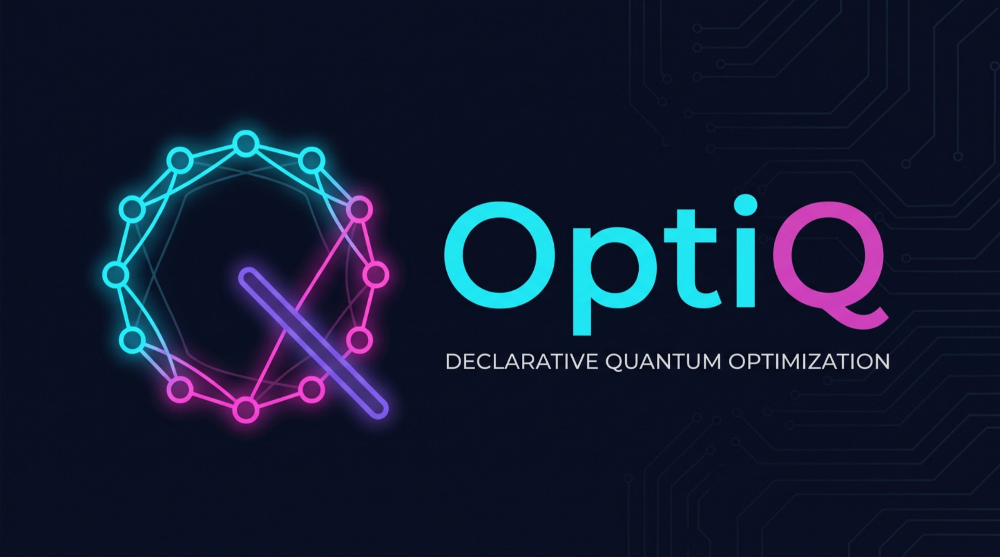
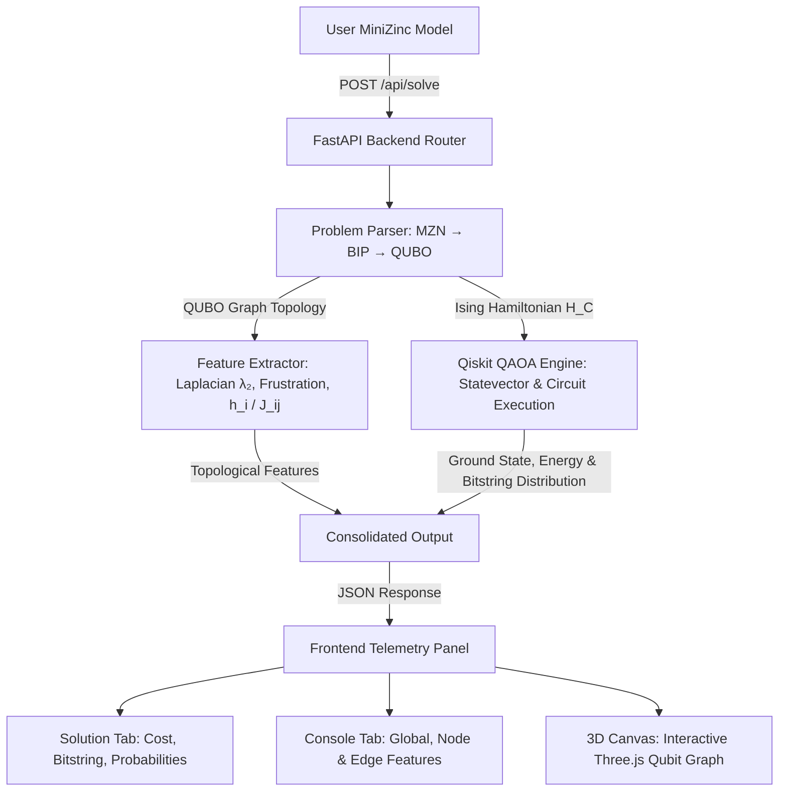

<p align="center">
  
</p>

# OptiQ - Declarative Quantum Optimization IDE

> ### 📖 Official Hackathon Documentation: [documentation.md](documentation.md)
> **Looking for the comprehensive project documentation, theoretical foundations, and Qollab guide? Read the full [documentation.md](documentation.md).**
>
> 🚀 **Live Interactive Web IDE:** [https://opti-q.vercel.app/](https://opti-q.vercel.app/)  
> 💻 **GitHub Repository:** [https://github.com/samuelArenas2005/OptiQ](https://github.com/samuelArenas2005/OptiQ)  
> ⚛️ **Attribution:** This effort is supported by Qollab & IonQ

---

## Overview

**OptiQ** is an interactive declarative quantum optimization platform and web IDE. It allows users to formulate **Binary Integer Programming (BIP)** problems in a high-level **MiniZinc-style** syntax, automatically compiles them into **QUBO / Ising** spin Hamiltonian models with slack qubits and penalty factors, extracts topological and spectral graph metrics, and solves them using **QAOA** (*Quantum Approximate Optimization Algorithm*) executed dynamically via **Qiskit**.

<p align="center">
  
</p>

---

## Why OptiQ Matters

Combinatorial optimization in critical areas such as logistics, supply chains, finance, molecular chemistry, and energy grids is one of the most promising frontiers for quantum advantage. **OptiQ** addresses the primary adoption barriers:

1. **Bridging the Abstraction Gap:** Eliminates the need to construct low-level quantum gates or manual Ising coupling matrices. Users write declarative constraints and objectives in a familiar MiniZinc syntax; OptiQ automatically converts inequalities to equalities using binary slack variables and quadratic penalty weights.
2. **Topological Feature Extraction & Barren Plateau Mitigation (QAOA + ML):** In NISQ variational algorithms, random angle initialization frequently causes barren plateaus. OptiQ analyzes the problem graph to extract the **Laplacian spectral gap ($\lambda_2$)**, **spectral radius ($\lambda_{\max}$)**, **frustration index**, and local node/edge biases ($h_i, J_{ij}$) to feed angle prediction models and informed heuristics.
3. **Telemetry & 3D Quantum Visualization:** Removes the "black-box" feel of quantum algorithms with an IDE featuring an interactive Three.js 3D qubit coupling canvas, live measurement probability distributions, feasibility verification, and execution logs.

---

## Key Features

- **Declarative MZN Editor:** Syntax highlighting for a MiniZinc subset, multi-tab workspace (up to 5 models), and preloaded benchmarks (Knapsack, Set Cover, Max-Cut, Vertex Cover, Bipartite Matching).
- **Autonomous QUBO / Ising Compiler:** Parses linear equality and inequality constraints ($\le, \ge, =$ and `sum(...)`), adds slack qubits, applies penalty weights, and converts to Pauli-Z operators ($x_i = \frac{I - Z_i}{2}$).
- **Spectral & Topological Graph Feature Extractor (`feature_extractor.py`):**
  - **Global Topology:** Qubit count $|V|$, coupling edges $|E|$, graph density, Laplacian spectral gap ($\lambda_2$), spectral radius ($\lambda_{\max}$), and cycle frustration index.
  - **Node & Edge Features:** Linear biases $h_i$, quadratic couplings $J_{ij}$, degrees $d_i$, clustering coefficients, and penalty allocations.
- **Qiskit QAOA Quantum Engine (`qaoa_solver.py`):**
  - Variational circuit construction using `QuantumCircuit`, `Statevector`, and classical optimizers (`COBYLA`, `Nelder-Mead`, `SLSQP`).
  - Hot runtime reconfiguration: shots (1,024 to 8,192), variational layers ($p$-steps), backend selector (Qiskit Statevector, AerSimulator, IonQ Cloud / Simulator), and angle schedules (Guided/PINN, Heuristic, Manual).
  - Measurement decoding, slack qubit marginalization, constraint validation, and optimal bitstring identification.
- **Consolidated Telemetry Panel:** Dedicated tabs for **Solution** (cost, bitstring, variables, distribution), **Console & Features** (global, node, edge metrics, logs), **3D Graph** (interactive Three.js canvas), and **Parameters** (QAOA configuration).

---

## Repository Structure

```text
OptiQ/
├── documentation.md              # 📖 Comprehensive project documentation & Qollab submission page
├── main.py                       # Standalone console runner & Qollab execution entrypoint
├── requirements.txt              # Top-level dependencies (Qiskit, SciPy, NumPy, FastAPI)
├── docker-compose.yml            # Production deployment config for containerized backend
├── Dockerfile                    # Multi-stage root build definition
├── backend/                      # FastAPI Python Backend
│   ├── main.py                   # FastAPI server entrypoint, CORS middleware & health check route
│   ├── requirements.txt          # Backend dependencies (pinned for production)
│   ├── Dockerfile                # Production Docker image (Python 3.11-slim, non-root user)
│   ├── .dockerignore             # Excludes cache, datasets, and local files
│   ├── api/
│   │   └── router.py             # REST API endpoints (POST /api/solve, POST /api/pinn/predict)
│   ├── parser/
│   │   ├── minizinc_parser.py    # Declarative MiniZinc syntax tokenizer & AST parser
│   │   ├── problem_parser.py     # Binary Integer Program -> QuadraticProgram -> QUBO compiler
│   │   └── test_parser.py        # Parser test suite
│   ├── quantum/
│   │   ├── qaoa_solver.py        # Qiskit QAOA circuit builder & executor (Aer, Statevector, IonQ)
│   │   └── feature_extractor.py  # Spectral Laplacian analysis, frustration index, graph features
│   ├── ml/
│   │   ├── pinn_model.py         # Physics-Informed Neural Network (PINN) angle inference interface
│   │   ├── export_to_onnx.py     # PyTorch to ONNX model export & numerical verification script
│   │   ├── train_pinn_qaoa.ipynb # Training notebook for the QAOA PINN model
│   │   ├── ARCHITECTURE_PINN.md  # Detailed architecture documentation of the PINN network
│   │   └── weights/              # Model weights (.pt), ONNX graph (.onnx), and scalers
│   └── dataset/
│       ├── generate_dataset.ipynb# Dataset generator for QAOA graph instances
│       └── qaoa_pignn_dataset.csv# Pre-generated dataset of 10,000 solved QAOA instances
├── frontend/                     # React 18 + Vite 5 + Tailwind CSS Web IDE
│   ├── index.html                # App entrypoint (Favicon & Google Fonts)
│   ├── vite.config.js            # Vite build configuration (envDir support)
│   ├── package.json              # Frontend dependencies
│   ├── .env.example              # Frontend environment variables template (VITE_API_URL)
│   ├── public/                   # Static assets (favicons, logos, visualizer embeds)
│   └── src/
│       ├── App.jsx               # Workspace orchestrator & state manager
│       ├── main.jsx              # React DOM render entrypoint
│       ├── index.css             # Design tokens & global stylesheet
│       ├── components/
│       │   ├── Header.jsx        # Top header with logo, title, and environment status
│       │   ├── MiniZincEditor.jsx# Multi-tab declarative code editor with syntax highlighting
│       │   ├── RightTelemetryPanel.jsx # Consolidated telemetry panel (solution, features, 3D, console)
│       │   ├── Visualizer3D.jsx  # Interactive Three.js qubit coupling graph
│       │   ├── BarChartVisualizer3D.jsx # 3D quantum state probability distribution visualizer
│       │   ├── BottomOutputCards.jsx # Fast-glance summary cards for solution bitstring & cost
│       │   ├── ResultsPanel.jsx  # Solution and feasible bitstring breakdown
│       │   ├── Console.jsx       # Real-time execution logs & parser output
│       │   ├── Hyperparameters.jsx # QAOA execution configuration panel (shots, p-steps, backend)
│       │   ├── AtomLoader.jsx    # 4-stage atomic compilation loader animation
│       │   └── SubtleParticles.jsx # Responsive interactive background particle canvas
│       ├── pipeline-visualizer/  # Interactive multi-stage quantum compilation visualizer modal
│       │   ├── PipelineModal.jsx # Orchestrator modal for pipeline inspection
│       │   ├── CodeParserStage.jsx # Stage 1: Declarative code parsing & AST tokenization
│       │   ├── GraphQuboStage.jsx # Stage 2: QUBO formulation & slack variable graph
│       │   ├── FeaturesStage.jsx # Stage 3: Spectral & topological metric extraction
│       │   ├── PinnStage.jsx     # Stage 4: PINN hyperparameter & angle recommendation
│       │   ├── CircuitComposerStage.jsx # Stage 5: Variational quantum circuit synthesis
│       │   ├── ShotStreamStage.jsx # Stage 6: Quantum measurement shot stream & distribution
│       │   ├── dataAdapter.js    # Transformer bridging backend API response to visualizer stages
│       │   └── mockData.js       # Fallback mock telemetry data for stage testing
│       ├── constants/
│       │   └── bipExamples.js    # Preloaded MiniZinc optimization models (Knapsack, Max-Cut, Set Cover)
│       ├── data/
│       │   ├── templates.js      # Declarative problem templates and syntax guides
│       │   └── datasets.js       # Benchmark graph datasets
│       └── services/
│           └── quantumApi.js     # HTTP client communicating with FastAPI backend (/solve & /pinn/predict)
└── docs/
    └── assets/                   # Architecture diagrams, screenshots, and logos
```

---

## Execution Pipeline



---

## Tech Stack

- **Frontend:** React 18, Vite 5, Tailwind CSS, Three.js, Lucide & Material Symbols.
- **Backend:** Python 3.11+, FastAPI, Uvicorn, Pydantic v2.
- **Quantum Simulation & Algorithms:** Qiskit 1.x / 2.x, Qiskit Optimization, Qiskit Aer, Qiskit IonQ.
- **Data Science & Graph Spectral Analysis:** SciPy (Sparse Laplacian Eigenvalues/Eigenvectors), NumPy, NetworkX.
- **DevOps & Deployment:** Docker, Docker Compose, Vercel (Frontend), OCI / Linux VPS (Backend).

---

## Getting Started

### 1. Standalone Console Demo (Qollab.xyz / Local Terminal)

To run the full end-to-end quantum optimization pipeline without starting web servers:

```bash
# Install dependencies
pip install -r requirements.txt

# Run the default 0/1 Knapsack benchmark (4 variables, 7 qubits with slack)
python main.py

# Or run other combinatorial benchmarks:
python main.py knapsack8    # 8-item Knapsack (12 qubits)
python main.py maxcut       # Max-Cut on graph
python main.py setcover     # Exact Set Cover
```

---

### 2. Full Local Web IDE (Frontend + Backend)

#### Step A: Start the FastAPI Backend
```bash
# From the repository root:
python main.py --server
# (Or: uvicorn backend.main:app --host 127.0.0.1 --port 8000 --reload)
```
The API will be available at `http://127.0.0.1:8000`.

#### Step B: Start the React Frontend
In a new terminal:
```bash
cd frontend
npm install
npm run dev
```
Open your browser at `http://localhost:3000` to interact with the full OptiQ IDE.

---

### 3. Production Deployment with Docker

To deploy the backend on an Oracle Cloud Infrastructure (OCI) instance, AWS EC2, or any Linux server:

```bash
# Build and run the container in the background
docker compose up -d --build

# View real-time logs
docker compose logs -f optiq-backend

# Verify health status
docker compose ps

# Stop the container
docker compose down
```

> **Cloud Firewall Note:** Make sure port `8000` is open in your cloud security list (Ingress Rules) and OS firewall:
> ```bash
> sudo iptables -I INPUT 6 -m state --state NEW -p tcp --dport 8000 -j ACCEPT
> sudo netfilter-persistent save
> ```

---

## API Specification

The FastAPI backend provides REST endpoints for declarative problem solving, spectral feature analysis, and PINN hyperparameter prediction.

### 1. Health Check: `GET /`

Returns the operational status of the backend server.

```json
{
  "message": "Quantum Solver Server is Running"
}
```

---

### 2. Full Quantum Solve: `POST /api/solve`

Parses declarative MiniZinc models into QUBO/Ising formulations, extracts topological and spectral graph metrics concurrently via a thread pool (`ThreadPoolExecutor`), evaluates PINN angle recommendations, and executes the QAOA simulation through Qiskit.

#### Request Body (`ProblemRequest`):

| Field | Type | Default | Description |
| :--- | :--- | :--- | :--- |
| `code` | `string` | *required* | High-level declarative MiniZinc model. |
| `solver` | `string` | `"qaoa"` | Target optimization solver. |
| `shots` | `integer` | `8192` | Measurement sampling shots (1,024 – 8,192). |
| `p_steps` | `integer` | `2` | Variational QAOA alternating layer depth ($p$). |
| `optimizer` | `string` | `"COBYLA"` | Classical parameter optimizer (`COBYLA`, `Nelder-Mead`, `SLSQP`). |
| `angle_init` | `string` | `"Automática"` | Angle initialization strategy (`Automática`, `PINN`, `Heurística`, `Manual`). |
| `gamma0` | `float` | `null` | Initial $\gamma$ angle (optional, for manual/hybrid modes). |
| `beta0` | `float` | `null` | Initial $\beta$ angle (optional, for manual/hybrid modes). |
| `backend` | `string` | `null` | Target backend (`"aer_simulator"`, `"statevector"`, `"ionq_simulator"`, `"ionq_qpu"`). |
| `backend_config` | `object` | `null` | Optional cloud backend configuration (e.g. `{"ionq_backend": "aria-1"}`). |

#### Request Example:
```json
{
  "code": "int: n = 4;\nint: capacity = 7;\narray[1..4] of int: weights = [2, 3, 4, 5];\narray[1..4] of int: profits = [3, 4, 5, 8];\narray[1..4] of var 0..1: x;\nconstraint sum(i in 1..n)(weights[i] * x[i]) <= capacity;\nsolve maximize sum(i in 1..n)(profits[i] * x[i]);",
  "solver": "qaoa",
  "shots": 8192,
  "p_steps": 2,
  "optimizer": "COBYLA",
  "angle_init": "Automática",
  "backend": "aer_simulator"
}
```

#### Response Example:
```json
{
  "status": "success",
  "message": "Problema parseado y resuelto exitosamente con QAOA ejecutado en Qiskit.",
  "parsed_summary": {
    "variables_count": 4,
    "variables": ["x[1]", "x[2]", "x[3]", "x[4]"],
    "constraints_count": 1,
    "constraints": ["2*x[1] + 3*x[2] + 4*x[3] + 5*x[4] <= 7"],
    "qubo_nodes": 7,
    "qubo_variables": ["x[1]", "x[2]", "x[3]", "x[4]", "slack_1", "slack_2", "slack_3"],
    "objective": "maximize 3*x[1] + 4*x[2] + 5*x[3] + 8*x[4]"
  },
  "features": {
    "global": {
      "num_variables_V": 7,
      "num_interactions_E": 21,
      "graph_density": 1.0,
      "laplacian_spectral_gap_lambda2": 242.4188,
      "spectral_radius_lambda_max": 512.8021,
      "global_frustration_index": 0.0
    },
    "nodes": [
      { "id": "x[1]", "degree": 6, "clustering": 1.0, "linear_bias_h": -14.5 }
    ],
    "edges": [
      { "source": "x[1]", "target": "x[2]", "weight_J": 24.0 }
    ],
    "console_summary": [
      "[SPECTRAL] Laplacian λ₂: 242.4188 | Frustration Index: 0.0000"
    ]
  },
  "pinn": {
    "p1": { "gamma": [0.6508], "beta": [2.5938] },
    "p2": { "gamma": [0.6508, 0.5092], "beta": [2.5938, -0.0585] },
    "gamma": [0.6508],
    "beta": [2.5938],
    "telemetry": {
      "recommended_shots": 1024,
      "recommended_lr_eta": 0.02,
      "target_depth_p_star": 1
    }
  },
  "details": {
    "solver_used": "qaoa",
    "qaoa_hyperparameters_used": {
      "shots": 8192,
      "p_steps": 2,
      "optimizer": "COBYLA",
      "angle_init": "Automática",
      "backend": "aer_simulator"
    },
    "solution": { "x[1]": 1, "x[2]": 0, "x[3]": 0, "x[4]": 1 },
    "optimal_bitstring": "1001",
    "optimal_value": 11.0,
    "energy": -11.0,
    "state_probability": "18.42%",
    "distribution": [
      { "bits": "1001", "prob": 0.1842, "fval": 11.0, "feasible": true, "peak": true },
      { "bits": "0101", "prob": 0.0912, "fval": 12.0, "feasible": false, "peak": false }
    ],
    "counts": { "1001": 1509, "0101": 747 },
    "shots": 8192,
    "p_layers": 2,
    "execution_time_ms": 3340.5,
    "qubits_count": 7,
    "circuit_depth": 38,
    "hardware": "Qiskit AerSimulator (Statevector Acelerado)",
    "qasm": "OPENQASM 2.0;\ninclude \"qelib1.inc\";\nqreg q[7];\n...",
    "console_logs": [
      "[INFO] Parsed MiniZinc: 4 decision vars, 3 slack qubits.",
      "[INFO] Variational circuit constructed with p=2 layers.",
      "[SUCCESS] Optimal bitstring decoded: 1001 (Value: 11.0, Feasible: True)"
    ]
  }
}
```

---

### 3. Fast PINN Inference: `POST /api/pinn/predict`

Lightweight endpoint providing sub-second inference of optimal variational angles ($\gamma, \beta$) and graph topological features directly from the declarative model **without** running full quantum statevector simulation.

#### Request Body (`PinnPredictRequest`):
```json
{
  "code": "int: n = 4;\nint: capacity = 7;\narray[1..4] of int: weights = [2, 3, 4, 5];\narray[1..4] of int: profits = [3, 4, 5, 8];\narray[1..4] of var 0..1: x;\nconstraint sum(i in 1..n)(weights[i] * x[i]) <= capacity;\nsolve maximize sum(i in 1..n)(profits[i] * x[i]);"
}
```

#### Response Example:
```json
{
  "status": "success",
  "pinn": {
    "p1": { "gamma": [0.6508], "beta": [2.5938] },
    "p2": { "gamma": [0.6508, 0.5092], "beta": [2.5938, -0.0585] },
    "gamma": [0.6508],
    "beta": [2.5938],
    "telemetry": {
      "recommended_shots": 1024,
      "recommended_lr_eta": 0.02,
      "target_depth_p_star": 1
    }
  },
  "features": {
    "global": {
      "num_variables_V": 7,
      "num_interactions_E": 21,
      "graph_density": 1.0,
      "laplacian_spectral_gap_lambda2": 242.4188,
      "spectral_radius_lambda_max": 512.8021,
      "global_frustration_index": 0.0
    }
  }
}
```

---

## Team

- [Ckancord33](https://github.com/Ckancord33)
- [samuelArenas2005](https://github.com/samuelArenas2005)
- [Sebastian6174](https://github.com/Sebastian6174)
- [Danicol12](https://github.com/Danicol12)

---

## Attribution & Support

> **This effort is supported by Qollab & IonQ**

---

## License

This project is licensed under the MIT License. See the [LICENSE](LICENSE) file for details.