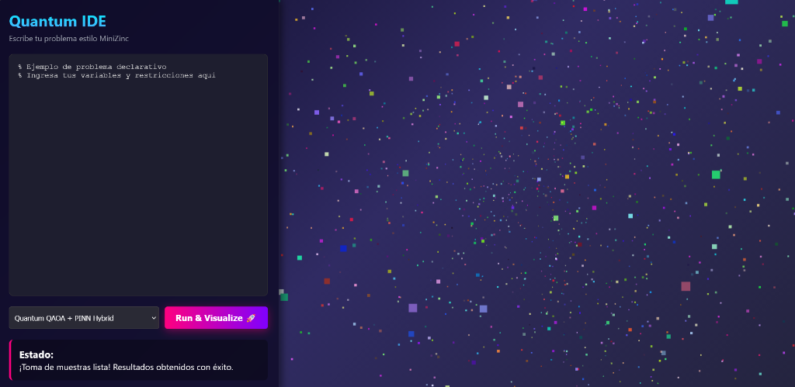
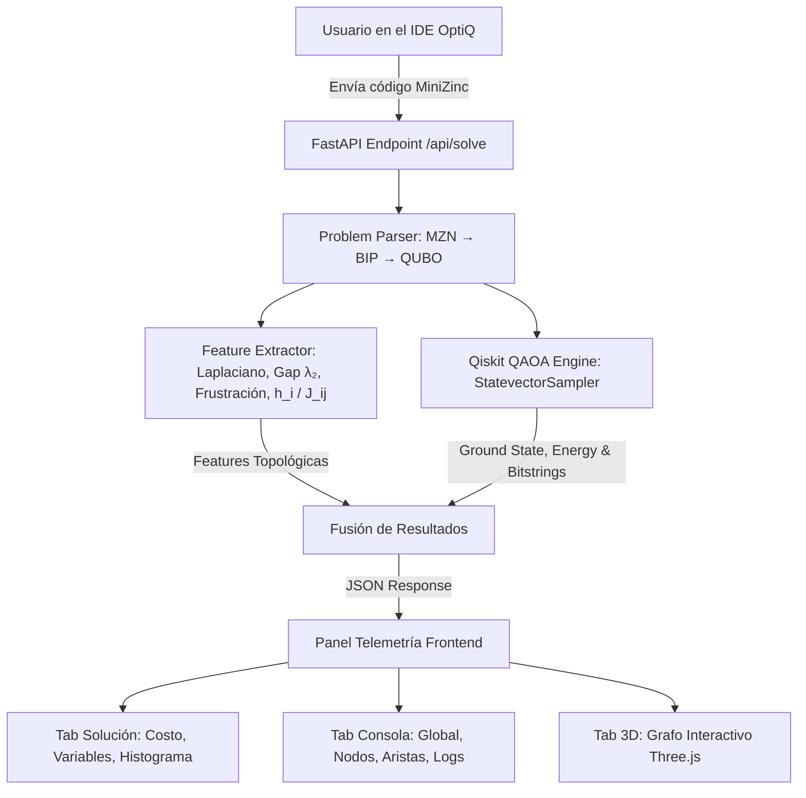

<p align="center">
  
</p>

# OptiQ - Quantum Optimization IDE

**OptiQ** es una plataforma interactiva y un IDE web de optimización cuántica declarativa. Permite formular problemas de **Programación Entera Binaria (BIP)** en una sintaxis estilo **MiniZinc**, traducirlos automáticamente a modelos cuadráticos **QUBO/Ising**, extraer métricas espectrales y topológicas del grafo, y resolverlos mediante **QAOA** (*Quantum Approximate Optimization Algorithm*) ejecutado dinámicamente con **Qiskit**.

<p align="center">
  
</p>

---

## ¿Por qué es importante este proyecto?

La optimización combinatoria en áreas críticas como logística, finanzas, diseño de fármacos y redes energéticas es uno de los campos de mayor impacto para la computación cuántica. **OptiQ** resuelve las tres grandes barreras de adopción actual:

1. **Cerrar la brecha de abstracción:** Elimina la necesidad de construir compuertas cuánticas o matrices Ising a mano. Permite escribir problemas en sintaxis declarativa tipo **MiniZinc**, convirtiéndolos automáticamente a QUBO con variables de holgura (*slack*) y penalizaciones cuadráticas.
2. **Extracción de Features Topológicas y Reducción de Barren Plateaus (QAOA + ML):** En algoritmos variacionales NISQ, la inicialización aleatoria de ángulos provoca el fenómeno de mesetas estériles (*barren plateaus*). OptiQ extrae métricas del Hamiltoniano como **gap espectral ($\lambda_2$)**, **índice de frustración global**, grados de conectividad y coeficientes $h_i/J_{ij}$ para alimentar modelos PINN de predicción de hiperparámetros.
3. **Telemetría y Visualización Cuántica 3D:** Hace transparente la "caja negra" cuántica mediante un entorno IDE que integra un canvas 3D interactivo en Three.js, gráficos de distribución de probabilidades de estados medidos (*Ground State*) y telemetría de ejecución en tiempo real.

---

## Características Principales

- **Editor Declarativo MZN:** Soporte para sintaxis estilo MiniZinc con coloreado sintáctico, autocompletado opcional desactivado para mayor control, y carga rápida de 5 modelos de ejemplo de Programación Entera Binaria (Knapsack, Set Cover, Max-Cut, Vertex Cover y Bipartite Matching).
- **Traductor QUBO / Ising Autónomo:** Parsea restricciones de igualdad y desigualdad ($\le, \ge, =$ y `sum`), agregando qubits de holgura automáticamente y construyendo la matriz de acoplamiento cuántico.
- **Extractor de Features Topológicas y Espectrales (`feature_extractor.py`):**
  - **Topología Global:** Número de Qubits $|V|$, acoplamientos $|E|$, Gap Espectral del Laplaciano ($\lambda_2$), Radio Espectral ($\lambda_{\max}$) e Índice de Frustración de Ciclos.
  - **Features de Nodos y Aristas:** Bias lineal $h_i$, acoplamientos cuadráticos $J_{ij}$, grados de conectividad $d_i$, coeficientes de clustering local y penalizaciones por restricción.
- **Motor Cuántico QAOA con Qiskit (`qaoa_solver.py`):**
  - Simulación de circuitos cuánticos variacionales utilizando `StatevectorSampler` y `MinimumEigenOptimizer`.
  - Configuración dinámica en caliente: número de disparos (*shots* hasta 8,192), capas cuánticas ($p$-steps), optimizadores clásicos (`COBYLA`, `Nelder-Mead`, `SPSA/Adam`, `SLSQP`) y estrategias de ángulos (Automática PINN, Heurística lineal o Manual).
  - Medición del estado base (*Ground State*), energía del Hamiltoniano $\langle H_{\text{cost}} \rangle$, histograma de distribución de estados y asignación binaria de variables.
- **Panel Lateral Consolidado de Telemetría:** Pestañas interactivas para **Solución**, **Consola & Features**, **Visualización 3D (Three.js)** y **Configuración de Parámetros**.

---

## Estructura del Proyecto

```text
HACKATONQ/
├── frontend/                     # Aplicación React + Vite + Tailwind CSS
│   ├── src/
│   │   ├── components/
│   │   │   ├── RightTelemetryPanel.jsx  # Panel de telemetría (Solución, Consola, 3D, Parámetros)
│   │   │   ├── CodeEditor.jsx           # IDE de código MiniZinc (JetBrains Mono)
│   │   │   ├── Visualizer3D.jsx         # Renderizador 3D de qubits e interacciones (Three.js)
│   │   │   └── AtomLoader.jsx           # Animación de carga atómica de 4 pasos
│   │   ├── services/
│   │   │   └── quantumApi.js            # Cliente HTTP para el backend FastAPI
│   │   ├── App.jsx                      # Componente principal con soporte multitarea
│   │   └── main.jsx                     # Punto de entrada de React
│   ├── package.json
│   └── vite.config.js
├── backend/                      # Servidor FastAPI
│   ├── main.py                   # Inicialización del servidor FastAPI y configuración CORS
│   ├── requirements.txt          # Dependencias (fastapi, uvicorn, qiskit, networkx, scipy, etc.)
│   ├── api/
│   │   └── router.py             # Endpoint POST /api/solve (Parsing → Features → QAOA Execution)
│   ├── parser/
│   │   └── problem_parser.py     # Parser MiniZinc → Programación Entera Binaria → QUBO
│   ├── quantum/
│   │   ├── qaoa_solver.py        # Solver QAOA con Qiskit (StatevectorSampler & optimizadores)
│   │   └── feature_extractor.py # Extractor de features topológicas, espectrales y frustración
│   └── ml/
│       └── pinn_model.py         # Predicción de hiperparámetros iniciales
├── docs/
│   └── assets/                   # Capturas, diagramas y logotipos
├── LICENSE
└── README.md
```

---

## Flujo de Ejecución



---

## Stack Tecnológico

- **Frontend:** React 18, Vite 5, Tailwind CSS, Three.js, Lucide / Material Symbols.
- **Backend:** Python 3.10+, FastAPI, Uvicorn.
- **Simulación Cuántica & Algoritmos:** Qiskit, Qiskit Optimization, Qiskit Algorithms.
- **Ciencia de Datos & Grafos:** NetworkX, SciPy (Análisis espectral de Eigenvalores/Eigenvectores del Laplaciano), NumPy.

---

## Instrucciones de Instalación y Ejecución

### 1. Requisitos Previos
- Node.js (v18 o superior)
- Python (v3.10 o superior)

### 2. Configurar e Iniciar el Backend (FastAPI)

```bash
# Desde la raíz del proyecto
cd backend

# Instalar dependencias de Python
pip install -r requirements.txt

# Iniciar el servidor FastAPI (servirá en http://127.0.0.1:8000)
python -m uvicorn main:app --host 127.0.0.1 --port 8000 --reload
```

### 3. Configurar e Iniciar el Frontend (React + Vite)

En una nueva terminal:

```bash
# Navegar a la carpeta frontend
cd frontend

# Instalar dependencias
npm install

# Iniciar servidor de desarrollo (disponible en http://localhost:3000)
npm run dev
```

Abre tu navegador en `http://localhost:3000` para comenzar a utilizar OptiQ.

---

## Superficie de la API

### Endpoint: `POST /api/solve`

#### Petición de ejemplo:
```json
{
  "code": "int: n = 4;\nint: capacity = 7;\narray[1..4] of int: weights = [2, 3, 4, 5];\narray[1..4] of int: profits = [3, 4, 5, 8];\narray[1..4] of var 0..1: x;\nconstraint sum(i in 1..n)(weights[i] * x[i]) <= capacity;\nsolve maximize sum(i in 1..n)(profits[i] * x[i]);",
  "solver": "qaoa",
  "shots": 8192,
  "p_steps": 2,
  "optimizer": "COBYLA",
  "angle_init": "Automática"
}
```

#### Respuesta de ejemplo:
```json
{
  "status": "success",
  "message": "Problema parseado y resuelto exitosamente con QAOA simulado en Qiskit.",
  "parsed_summary": {
    "variables_count": 4,
    "variables": ["x[1]", "x[2]", "x[3]", "x[4]"],
    "constraints_count": 1,
    "qubo_nodes": 7
  },
  "features": {
    "global": {
      "num_variables_V": 7,
      "num_interactions_E": 21,
      "laplacian_spectral_gap_lambda2": 242.4188,
      "global_frustration_index": 1.0
    }
  },
  "details": {
    "optimal_value": 11.0,
    "optimal_bitstring": "1001",
    "solution": { "x_1": 1, "x_2": 0, "x_3": 0, "x_4": 1 },
    "energy": -11.0,
    "execution_time_ms": 27555.61,
    "distribution": [
      { "bits": "1001", "prob": 0.002, "fval": 11.0, "feasible": true, "peak": true }
    ]
  }
}
```

---

## Equipo

- [Ckancord33](https://github.com/Ckancord33)
- [samuelArenas2005](https://github.com/samuelArenas2005)
- [theClowner](https://github.com/theClowner)
- [Danicol12](https://github.com/Danicol12)

---

## Licencia

Este proyecto está licenciado bajo la licencia MIT. Consulta el archivo [LICENSE](LICENSE) para más información.