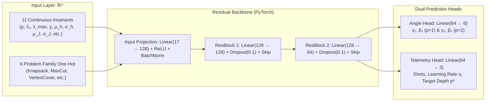

<p align="center">
  
</p>

# OptiQ: declarative quantum optimization

> **Try it now → [opti-q.vercel.app](https://opti-q.vercel.app/)** · **Source code → [github.com/samuelArenas2005/OptiQ](https://github.com/samuelArenas2005/OptiQ)**
> The full IDE runs in your browser: write a model, press **RUN**, and see the QAOA results, the probability histogram of measured states, and the best feasible solution selected directly from the quantum distribution.
>
> ⚛️ **Attribution:** *This effort is supported by Qollab & IonQ*

**OptiQ** lets you describe an optimization problem the way you would on paper, in a **MiniZinc-style** language, and solves it with **QAOA** in Qiskit. No gates, no Hamiltonians by hand: OptiQ compiles your model to a **binary program**, then to a **QUBO / Ising Hamiltonian**, builds the quantum circuit, runs it, and checks the best answer.

There are two ways to use it:

| | Where | What you get |
|---|---|---|
| **Web IDE** | [opti-q.vercel.app](https://opti-q.vercel.app/) | Editor, parameter panel, solution, histogram, graph features and 3D view |
| **Qollab** | Press **Run** on this page | The same pipeline in the console via `main.py`, plus Qollab's Circuit and Probabilities widgets |
| **GitHub** | [samuelArenas2005/OptiQ](https://github.com/samuelArenas2005/OptiQ) | Full source: backend, React frontend, dataset and Docker deployment |

---

## Contents

1. [What it shows](#what-it-shows)
2. [Why it matters](#why-it-matters)
3. [Background: binary programming and MiniZinc](#background-binary-programming-and-minizinc)
4. [QAOA in a nutshell](#qaoa-in-a-nutshell)
5. [From a binary program to a QAOA circuit](#from-a-binary-program-to-a-qaoa-circuit)
6. [Tuning γ and β: classical optimizers and PINNs](#tuning-γ-and-β-classical-optimizers-and-pinns)
7. [Shots, probabilities and the answer](#shots-probabilities-and-the-answer)
8. [Computational limits and scaling](#computational-limits-and-scaling)
9. [Run it on Qollab](#run-it-on-qollab)
10. [How it works](#how-it-works)
11. [Project Structure & In-Depth Guide](#project-structure--in-depth-guide)
12. [Make it yours](#make-it-yours)
13. [Credits](#credits)

---

## What it shows

<p align="center">
  
</p>

### The interface

The screen has two areas:

**Left (2/3): the MiniZinc editor**
- Up to 5 tabs of `.mzn` models.
- **Examples** menu with ready-made problems: Knapsack, Set Cover, Max-Cut, Vertex Cover and Bipartite Matching.

**Right (1/3): run and telemetry panel**
- **RUN** solves the model. **RUN & VISUALIZE** solves it and opens the 3D view.
- A status bar shows the shots and whether the run succeeded.
- Four tabs:

| Tab | What you see |
|---|---|
| **Parámetros** | QAOA settings: layers `p`, shots (1,024 to 8,192), classical optimizer, angle initialization (Automatic / Heuristic / Manual with γ₀, β₀) and backend |
| **Solución** | Optimal value, chosen bitstring, value of each variable, and the **state distribution histogram**, with feasible states and the optimum highlighted |
| **Consola** | Graph features in sub-tabs (**Global**, **Nodes**, **Edges**) plus the solver **Logs** |
| **3D** | Interactive Three.js graph: qubits are nodes, QUBO couplings are edges |

<!-- TODO screenshots (save in docs/assets/ and push):


-->

### A run, end to end

Take the default **0/1 Knapsack**: 4 items, weights `[2, 3, 4, 5]`, values `[3, 4, 5, 8]`, capacity 7.

1. OptiQ adds **3 slack qubits** for the `<= 7` constraint, so the circuit has **7 qubits** (4 items + 3 slack).
2. QAOA runs and measures a distribution of bitstrings across the shots.
3. OptiQ decodes the measured states, filters out infeasible configurations, and selects the best candidate among the feasible states: `x = [1, 0, 0, 1]` with value **11**.
4. *(Optional in console)*: In `main.py`, a classical exact check (exhaustive search) runs alongside as a benchmark to verify that 11 matches the theoretical global optimum and compute the approximation ratio. The Web IDE itself does not run classical brute force; it relies purely on quantum sampling.

<!-- TODO: table with real results for the 4 benchmarks (qubits, true optimum, QAOA value, ratio, time) -->

---

## Why it matters

Combinatorial optimization (routing, scheduling, portfolio selection, network design) is one of the most promising uses of near-term quantum computers. Today, using QAOA still means writing Hamiltonians and penalty terms by hand. OptiQ removes that barrier:

- **Declarative in, quantum out.** You write constraints and an objective. OptiQ handles slack variables, penalties and the Ising mapping.
- **Insight into the problem.** Spectral and topological features (λ₂, λ_max, frustration, `h_i`, `J_ij`) show how hard the landscape is for QAOA.
- **A path to smarter QAOA.** The same features feed a dataset of about 10,000 solved instances, built to train a model that predicts good starting angles (see [Tuning γ and β](#tuning-γ-and-β-classical-optimizers-and-pinns)).

### Target Audience: Who is it for?

OptiQ is designed for a wide spectrum of problem-solvers bridging the gap between classical operations research and quantum computing:

1. **Operations Researchers & Optimization Engineers:** Professionals in logistics, supply chain, finance, and industrial planning who are accustomed to high-level algebraic modeling languages (MiniZinc, AMPL, Pyomo). They can define constraints and objectives declaratively without having to derive Ising spin couplings or penalty formulas by hand.
2. **Quantum Computing Researchers & Students:** Practitioners learning or benchmarking variational algorithms (QAOA) on real hardware (IonQ) or simulators with Qiskit. OptiQ offers an intuitive visual environment, transparent graph analysis (spectral gap $\lambda_2$, frustration), and live measurement histograms.
3. **Machine Learning & AI Researchers:** Data scientists interested in Physics-Informed Neural Networks (PINNs) and topological feature extraction for optimizing quantum circuits and mitigating *barren plateaus*.
4. **Software Developers & Prototypers:** Engineers needing a clean, modular REST API (`POST /api/solve`), containerized Docker deployment, or a modern browser-based IDE to prototype quantum solutions rapidly.

---

## Background: binary programming and MiniZinc

### Binary programming in one paragraph

A **Binary Integer Program (BIP)** is an optimization problem whose decision variables can only be 0 or 1 ("take the item or not", "use the edge or not"). You maximize or minimize a linear objective subject to linear constraints. Many classic NP-hard problems (Knapsack, Set Cover, Vertex Cover, Max-Cut) fit this form.

- [Integer programming (Wikipedia)](https://en.wikipedia.org/wiki/Integer_programming)
- [QUBO, the unconstrained quadratic form QAOA needs (Wikipedia)](https://en.wikipedia.org/wiki/Quadratic_unconstrained_binary_optimization)
- [Glover et al., *A Tutorial on Formulating and Using QUBO Models* (arXiv:1811.11538)](https://arxiv.org/abs/1811.11538)

### MiniZinc

[**MiniZinc**](https://www.minizinc.org/) is a free, open-source **constraint modelling language**. You state *what* a solution must satisfy, not *how* to find it, and a solver does the rest. OptiQ supports the subset needed for binary programs and uses a quantum solver behind it.

The four building blocks:

```minizinc
int: capacity = 7;                                % parameter (fixed data)
array[1..4] of int: weights = [2, 3, 4, 5];       % parameter array
array[1..4] of var 0..1: x;                       % binary decision variables

constraint sum(i in 1..4)(weights[i] * x[i]) <= capacity;   % constraint
solve maximize sum(i in 1..4)(values[i] * x[i]);            % objective
```

| Construct | Meaning |
|---|---|
| `int: n = 4;` | A constant |
| `array[1..n] of var 0..1: x;` / `var 0..1: y;` | Binary decision variables |
| `constraint ... <= / >= / = ...;` | Linear constraints, with `sum(i in 1..n)(...)` |
| `solve maximize ...;` / `solve minimize ...;` | The objective |

Learn more: [MiniZinc Handbook](https://docs.minizinc.dev/en/stable/) · [Basic modelling tutorial](https://docs.minizinc.dev/en/stable/modelling.html)

**In the code:** [`backend/parser/minizinc_parser.py`](https://github.com/samuelArenas2005/OptiQ/blob/main/backend/parser/minizinc_parser.py) reads the model into variables, linear constraints and an objective.

---

## QAOA in a nutshell

The **Quantum Approximate Optimization Algorithm** ([Farhi, Goldstone & Gutmann, 2014](https://arxiv.org/abs/1411.4028)) is a hybrid quantum-classical algorithm for problems written as a cost Hamiltonian `H_C`, whose lowest-energy state encodes the best solution.

The circuit:

1. **Start** in an equal superposition of every bitstring (a Hadamard on each qubit).
2. **Repeat `p` layers.** Each layer applies:
   - the **cost layer** `exp(-i γₖ H_C)`, which marks good solutions with a phase;
   - the **mixer layer** `exp(-i βₖ Σ Xᵢ)`, which makes those phases interfere.
3. **Measure.** Good solutions should now come out with high probability.

Each layer `k` has its own pair of angles, so a depth-`p` circuit has **2p parameters**: `γ = (γ₁ … γₚ)` and `β = (β₁ … βₚ)`. A classical optimizer adjusts them to minimize the energy `⟨H_C⟩`. More layers give a better approximation, at the cost of a deeper circuit and a harder optimization.

References:
- [IBM Quantum tutorial: Quantum Approximate Optimization Algorithm](https://quantum.cloud.ibm.com/docs/en/tutorials/quantum-approximate-optimization-algorithm)
- [IBM Quantum tutorial: Advanced techniques for QAOA](https://quantum.cloud.ibm.com/docs/en/tutorials/advanced-techniques-for-qaoa)
- [Qiskit Algorithms: QAOA tutorial](https://qiskit-community.github.io/qiskit-algorithms/tutorials/05_qaoa.html)

**In the code:** `build_qaoa_circuit` in [`backend/quantum/qaoa_solver.py`](https://github.com/samuelArenas2005/OptiQ/blob/main/backend/quantum/qaoa_solver.py) builds the ansatz: `H` gates, then per layer `Rz`/`Rzz` for the cost terms and `Rx(2β)` for the mixer.

---

## From a binary program to a QAOA circuit

QAOA can't take constraints directly. It needs a single energy function. OptiQ gets there in four steps:

```
MiniZinc model ──► BIP ──► QUBO ──► Ising Hamiltonian ──► QAOA circuit
```

| Step | What happens | File |
|---|---|---|
| **1. Parse** | MiniZinc → binary variables, linear constraints, objective | [`minizinc_parser.py`](https://github.com/samuelArenas2005/OptiQ/blob/main/backend/parser/minizinc_parser.py) |
| **2. BIP** | Build a Qiskit `QuadraticProgram` | [`problem_parser.py`](https://github.com/samuelArenas2005/OptiQ/blob/main/backend/parser/problem_parser.py) |
| **3. QUBO** | Remove constraints (details below) | [`problem_parser.py`](https://github.com/samuelArenas2005/OptiQ/blob/main/backend/parser/problem_parser.py) |
| **4. Ising** | Map to Pauli Z operators | [`qaoa_solver.py`](https://github.com/samuelArenas2005/OptiQ/blob/main/backend/quantum/qaoa_solver.py) |

**Step 3, removing the constraints.** Qiskit's `QuadraticProgramToQubo` does three things:
- **Inequalities become equalities** by adding binary **slack variables**, which become extra qubits. For example, `Σ wᵢxᵢ ≤ 7` becomes `Σ wᵢxᵢ + s = 7`, with `s` written in binary.
- **Equalities become penalties.** Each one turns into a quadratic term `P · (Σ aᵢxᵢ − b)²` that adds energy whenever the constraint is broken.
- **Maximize becomes minimize** by flipping the sign.

**Step 4, the Ising map.** Substituting `xᵢ = (1 − Zᵢ)/2` gives `H_C = Σ hᵢ Zᵢ + Σ Jᵢⱼ ZᵢZⱼ + const`. This is exactly what the cost layer of QAOA applies.

**Graph features.** The QUBO is also a weighted graph: each qubit is a node and each `Jᵢⱼ ≠ 0` is an edge. [`backend/quantum/feature_extractor.py`](https://github.com/samuelArenas2005/OptiQ/blob/main/backend/quantum/feature_extractor.py) computes:
- density;
- the Laplacian **spectral gap λ₂** (how well connected the graph is);
- the **spectral radius λ_max**;
- a **frustration index** (how much the couplings conflict);
- per-node and per-edge features.

More: [Qiskit Optimization: converters for quadratic programs](https://qiskit-community.github.io/qiskit-optimization/tutorials/02_converters_for_quadratic_programs.html) · [Lucas, *Ising formulations of many NP problems* (arXiv:1302.5843)](https://arxiv.org/abs/1302.5843)

---

## Tuning γ and β: classical optimizers and PINNs

QAOA is only as good as its angles. OptiQ splits the job into two parts:

**1. Where to start: initial angles γ₀, β₀**
- **Manual:** you set γ₀ and β₀.
- **Heuristic:** γ grows and β shrinks across the layers, a schedule inspired by adiabatic evolution.
- **Automatic (PINN):** a **Physics-Informed Neural Network** ([Raissi et al., 2019](https://arxiv.org/abs/1711.10561)) predicts the starting angles directly from the problem's spectral and topological graph features, steering the statevector directly into basins of attraction and mitigating *barren plateaus* that random initialization frequently encounters.

**2. How to refine them: a classical optimizer**
- The optimizer minimizes `⟨H_C⟩`, evaluated exactly with Qiskit's `Statevector` or sampled shots.
- Available methods (SciPy): **COBYLA** (default, gradient-free), **Nelder-Mead** and **SLSQP**. When initialized with PINN predictions, convergence requires significantly fewer classical optimization steps.

---

### The PINN Architecture & Production Model

OptiQ deploys a lightweight, standalone deep neural network informed by quantum physics, fully integrated in [`backend/ml/pinn_model.py`](https://github.com/samuelArenas2005/OptiQ/blob/main/backend/ml/pinn_model.py) and backed by pre-trained weights in [`backend/ml/weights/pinn_qaoa_weights.pt`](https://github.com/samuelArenas2005/OptiQ/blob/main/backend/ml/weights/pinn_qaoa_weights.pt).



#### 1. Input Representation (ℝ¹⁷)
The network receives an invariant vector derived in O(|V| + |E|) by [`extract_bip_features`](https://github.com/samuelArenas2005/OptiQ/blob/main/backend/quantum/feature_extractor.py):
1. **11 continuous topological and spectral invariants:** number of qubits (*n*), coupling edges (*m*), graph density (*ρ*), Laplacian spectral gap (*λ₂*), spectral radius (*λ_max*), signed Laplacian frustration index (*χ*), linear field statistics (*μ_h, σ_h*), quadratic coupling statistics (*μ_J, σ_J*), and penalty multiplier (*λ*).
2. **6 one-hot family indicators:** encodes specific energy landscapes (Knapsack, MaxCut-Regular, MaxCut-Barabási-Albert, MaxCut-Erdős-Rényi, Frustrated Ising, and Vertex Cover).

#### 2. Quantum Physics-Informed Symmetric Loss (L_PINN)
Standard MSE loss fails for variational quantum angles due to phase wrap-around discontinuities. OptiQ trains the network with a custom periodic quantum metric:

> **L_quantum(θ̂, θ\*) = min( |θ̂ − θ\*|, |θ̂ − (θ\* ± π)| )**

Combined with Pauli boundary regularizers on `[−π, π]` for **γ** and `[−π/2, π/2]` for **β**, and adiabatic monotonicity constraints:

> **L_total = L_quantum + λ_phys · L_boundary + λ_adiab · L_monotonicity**

#### 3. Validation and Benchmarks
- **Dataset:** 10,000 systematically solved BIP instances in [`backend/dataset/qaoa_pignn_dataset.csv`](https://github.com/samuelArenas2005/OptiQ/blob/main/backend/dataset/qaoa_pignn_dataset.csv).
- **Stratified 5-Fold Cross Validation:** Generalization error verified at **MAE = 0.3037 ± 0.0038 rad**.
- **Runtime Performance & Zero-PyTorch Deployment:** The model is exported to ONNX format ([`pinn_qaoa.onnx`](https://github.com/samuelArenas2005/OptiQ/blob/main/backend/ml/weights/pinn_qaoa.onnx), ~339 KB) and executed via **ONNX Runtime** with pure NumPy arrays. This avoids bloated PyTorch installations in containerized production environments (keeping Docker images featherlight) while delivering **sub-millisecond (< 1 ms)** inference latency on CPU.

#### 4. Arbitrary Depth Scaling: Adiabatic Schedule & Mitigating Barren Plateaus
When QAOA is configured with depths beyond $p=2$ (up to $p=8$ in the IDE), OptiQ dynamically constructs and optimizes the remaining angles:

1. **Output Head Structure:** The 6 output neurons of the angle head represent the fundamental baselines for depth $p=1$ (2 angles: $\gamma_{1,0}, \beta_{1,0}$) and depth $p=2$ (4 angles: $\gamma_{2,0}, \gamma_{2,1}, \beta_{2,0}, \beta_{2,1}$), rather than an arbitrary static depth.
2. **Quantum Adiabatic Schedule:** For any target depth $p$, the PINN ground angles $(\gamma_0, \beta_0)$ seed a complete vector of $2p$ parameters through an adiabatic evolution schedule ([`qaoa_solver.py`](https://github.com/samuelArenas2005/OptiQ/blob/main/backend/quantum/qaoa_solver.py#L282-L286)):
   > **γ_k^(init) = γ₀ · (0.4 + 0.6 · (k + 1) / p)**  
   > **β_k^(init) = β₀ · (1.0 − 0.7 · k / p)**, &nbsp; for *k = 0, …, p − 1*
   - *Physical foundation:* In Quantum Adiabatic Computing (AQC), adiabatic state preparation requires ramping up the problem Hamiltonian $H_C$ (increasing phase angles $\gamma$) while progressively turning down the mixer Hamiltonian $H_M$ (decreasing mixer angles $\beta$).
3. **Mitigating Barren Plateaus:** In Variational Quantum Algorithms (VQAs), random angle initialization causes the cost gradient to vanish exponentially with qubit count—the notorious *Barren Plateau* phenomenon (where variance decays as O(2⁻ⁿ)). By anchoring the starting point to the graph's spectral and topological features, OptiQ seeds the parameters directly inside the energy landscape's basin of attraction.
4. **Classical Outer-Loop Refinement:** Starting from this informed basin, the classical optimizer (COBYLA, Nelder-Mead, or SLSQP) only needs a few iterations (<15 evaluations) to fine-tune all $2p$ variational angles, synthesizing the optimal $p$-layer ansatz circuit in Qiskit.

**In the code:**
- Inference engine (ONNX Runtime + PyTorch fallback): [`pinn_model.py`](https://github.com/samuelArenas2005/OptiQ/blob/main/backend/ml/pinn_model.py)
- ONNX export utility: [`export_to_onnx.py`](https://github.com/samuelArenas2005/OptiQ/blob/main/backend/ml/export_to_onnx.py)
- Pretrained weights: [`pinn_qaoa.onnx`](https://github.com/samuelArenas2005/OptiQ/blob/main/backend/ml/weights/pinn_qaoa.onnx) & [`pinn_qaoa_weights.pt`](https://github.com/samuelArenas2005/OptiQ/blob/main/backend/ml/weights/pinn_qaoa_weights.pt)
- Training & Cross-Validation pipeline: [`train_pinn_qaoa.ipynb`](https://github.com/samuelArenas2005/OptiQ/blob/main/backend/ml/train_pinn_qaoa.ipynb)
- Mathematical architecture documentation: [`ARCHITECTURE_PINN.md`](https://github.com/samuelArenas2005/OptiQ/blob/main/backend/ml/ARCHITECTURE_PINN.md)
- QAOA execution & angle binding: `run_qaoa` in [`qaoa_solver.py`](https://github.com/samuelArenas2005/OptiQ/blob/main/backend/quantum/qaoa_solver.py)

---

## Shots, probabilities and the answer

A quantum circuit doesn't return one answer. Each run ("shot") collapses to one bitstring at random, following the probabilities QAOA built.

- **More shots, sharper histogram.** With 8,192 shots, the frequency of each bitstring closely matches its true probability. With few shots, rare states can be missed.
- **The tallest bar is the most likely state, not always the optimum.** QAOA with a small `p` spreads probability over several good states. Slack qubits can also scatter it.
- **How OptiQ picks the answer (no classical brute force in the IDE):**
  1. **Ignore slack qubits.** Sum the marginal probabilities of all measured bitstrings that share the same physical decision variables.
  2. **Filter feasible quantum samples.** Check each sampled state against the original model constraints to identify which ones are valid.
  3. **Pick the best candidate among feasible states.** From the top sampled feasible configurations, OptiQ selects the one that maximizes (or minimizes) the objective value. This candidate is highlighted with the **Óptimo** badge in the histogram.
  4. **Classical verification only for benchmarking.** In the terminal runner (`main.py`), a classical exhaustive solver is run exclusively to calculate the approximation ratio and evaluate QAOA's performance against ground truth. The Web IDE operates purely on the quantum sampling results.
- **Configure it well and it lands on the optimum.** With adequate layers (p), guided angle initialization, and sufficient shots, the true ground state appears among the top measured states with high probability.

**In the code:** sampling, slack marginalization, feasibility checks and solution selection are in `run_qaoa` ([`qaoa_solver.py`](https://github.com/samuelArenas2005/OptiQ/blob/main/backend/quantum/qaoa_solver.py)). The exact check is `solve_classical_exact` in [`main.py`](https://github.com/samuelArenas2005/OptiQ/blob/main/main.py).

---

## Computational limits and scaling

Because OptiQ compiles declarative models into quantum circuits, the total number of required qubits equals:

> **Total Qubits (n) = Decision Variables (|V|) + Slack Qubits (s)**

Where slack variables are automatically introduced by the QUBO compiler to encode inequality constraints (such as `Σ wᵢxᵢ ≤ C`).

### Classical Statevector Simulation Scaling: O(2ⁿ)

Simulating quantum states classically requires storing and evolving the full statevector of 2ⁿ complex amplitudes. Consequently, classical memory requirements and execution times scale **exponentially with qubit count (O(2ⁿ))**:

| Total Qubits (*n*) | Statevector Dimension | Memory Required | Execution Latency | Recommended Target |
|---|---|---|---|---|
| **1 – 16 qubits** | Up to 65,536 amplitudes | < 1 MB | **Real-time (< 2s)** | Web IDE & Qollab Simulator |
| **17 – 20 qubits** | Up to 1,048,576 amplitudes | ~16 MB | **Fast (2 – 10s)** | Web IDE & Local Aer |
| **21 – 22 qubits** | Up to 4,194,304 amplitudes | ~64 MB | **Acceptable (10 – 30s)** | Dedicated execution |
| **23+ qubits** | ≥ 16,777,216 amplitudes | ≥ 256 MB – GBs | **Risk of Timeout / OOM** | Physical QPU (IonQ Hardware) |

---

## Run it on Qollab

OptiQ supports multiple execution workflows depending on your environment—from zero-install cloud execution on Qollab to a standalone console demo, a full local web IDE, and containerized Docker deployment:

### 1. In Qollab (`Qollab.xyz` runtime)
Run directly inside the Qollab cloud environment with zero setup:
1. Press **Run** in the Qollab toolbar and select either the **Built-in simulator** or the **IonQ simulator**.
2. `main.py` detects Qollab's global `backend` context automatically, runs the complete 7-step pipeline on the default **4-item Knapsack**, and executes in **a single job** (compatible with IonQ cloud requirements).
3. When execution finishes, Qollab's native **Circuit** and **Probabilities** widgets display the QAOA quantum circuit and the measured bitstring counts.

> [!TIP]
> The angle optimization runs locally on an exact statevector. Only the final, optimized circuit is sent to the backend, so **each run uses a single job**, which is what IonQ backends on Qollab require.

---

### 2. Standalone Console Demo (Local Terminal CLI)
To test the complete end-to-end quantum optimization pipeline on an example problem without launching web servers or opening a browser:

```bash
# 1. Clone the repository and install dependencies
git clone https://github.com/samuelArenas2005/OptiQ.git
cd OptiQ
pip install -r requirements.txt

# 2. Run the default 0/1 Knapsack benchmark (4 items, 7 qubits with slack)
python main.py

# 3. Or run other preconfigured combinatorial benchmarks:
python main.py knapsack8    # 8-item Knapsack (12 qubits with slack)
python main.py maxcut       # Max-Cut on graph
python main.py setcover     # Exact Set Cover problem
```

Each benchmark prints 7 detailed steps in the terminal:
1. **Model:** The high-level MiniZinc specification.
2. **BIP & QUBO compilation:** Slack qubit allocation and penalty terms.
3. **Graph features:** Laplacian spectral gap ($\lambda_2$), spectral radius ($\lambda_{\max}$), and frustration index.
4. **Initial angles:** Heuristic or PINN-predicted $(\gamma_0, \beta_0)$ angles.
5. **QAOA execution:** Variational circuit evaluation on Qiskit Aer or IonQ.
6. **Measured distribution:** Top measured bitstrings, marginal probabilities, and feasibility validation.
7. **Exact classical check:** Exhaustive solver to verify the true ground state and compute the approximation ratio.

---

### 3. Full Local Web IDE (FastAPI Backend + React Frontend)
To run the complete interactive IDE locally on your machine with the code editor, 3D visualizer, and telemetry panels:

#### Step A: Start the FastAPI Backend
In your first terminal:
```bash
# From the repository root:
python main.py --server
# Or launch directly with uvicorn:
# uvicorn backend.main:app --host 127.0.0.1 --port 8000 --reload
```
The REST API will start at `http://127.0.0.1:8000` (Swagger interactive docs at `http://127.0.0.1:8000/docs`).

#### Step B: Start the React Web IDE
In a second terminal:
```bash
cd frontend
npm install
npm run dev
```
Open your browser at `http://localhost:3000` (or `http://localhost:5173`) to use the full OptiQ IDE: write custom `.mzn` models, adjust QAOA hyperparameters, visualize the 3D qubit coupling graph, and run the quantum solver.

---

### 4. Production Deployment with Docker
For containerized deployment on any cloud server (Oracle Cloud Infrastructure OCI, AWS EC2, or Linux VPS):

```bash
# Build and run the backend container in the background
docker compose up -d --build

# Inspect real-time execution logs
docker compose logs -f optiq-backend

# Check container status
docker compose ps

# Stop the container
docker compose down
```

> [!NOTE]
> Ensure port `8000` is open in your cloud security list (Ingress Rules) and OS firewall to allow external traffic to the backend API.

---

## How it works

```
main.py                              Qollab entry point: full pipeline + console report
backend/parser/minizinc_parser.py    MiniZinc subset -> variables, constraints, objective
backend/parser/problem_parser.py     BIP -> QuadraticProgram -> QUBO (slack + penalties)
backend/quantum/feature_extractor.py Laplacian spectrum, frustration, h_i / J_ij features
backend/quantum/qaoa_solver.py       QAOA circuit, angle optimization, backend run, decoding
backend/ml/pinn_model.py             initial angles (gamma_0, beta_0)
backend/dataset/                     dataset notebook + qaoa_pignn_dataset.csv (10k instances)
backend/api/router.py                POST /api/solve, used by the web IDE
frontend/                            React + Vite + Three.js IDE (opti-q.vercel.app)
requirements.txt                     qiskit, qiskit-optimization, numpy, scipy
```

<!-- TODO: Qollab runtime notes (backend global, circuit/counts widgets, web IDE hosting) -->

---

## Project Structure & In-Depth Guide

For detailed, step-by-step instructions on running the project locally (FastAPI backend + React Vite frontend), full production deployment with Docker Compose on Oracle Cloud Infrastructure (OCI), API endpoint specifications (`POST /api/solve`), and the complete file tree, please visit the **[README.md](README.md)** (or on GitHub: **[README.md](https://github.com/samuelArenas2005/OptiQ/blob/main/README.md)**).


---

## Make it yours

1. **Add a problem.** Add an entry to `BENCHMARKS` in `main.py` with MiniZinc code using `var 0..1` variables, or paste it into the [web IDE](https://opti-q.vercel.app/).
2. **Add a graph feature.** Extend `extract_bip_features` in `backend/quantum/feature_extractor.py`.
3. **Plug in your own angle predictor.** Replace `get_hyperparameters` in `backend/ml/pinn_model.py` with a model trained on `qaoa_pignn_dataset.csv`.

---

## Credits

OptiQ is by [Ckancord33](https://github.com/Ckancord33), [samuelArenas2005](https://github.com/samuelArenas2005), [Sebastian6174](https://github.com/Sebastian6174) and [Danicol12](https://github.com/Danicol12), released under the MIT License (see `LICENSE`).

> **This effort is supported by Qollab & IonQ**

- Live app: [opti-q.vercel.app](https://opti-q.vercel.app/)
- Source: [github.com/samuelArenas2005/OptiQ](https://github.com/samuelArenas2005/OptiQ)

<!-- TODO: demo video link -->
<!-- TODO: "What existed before the build window" disclosure (required by the rules) -->